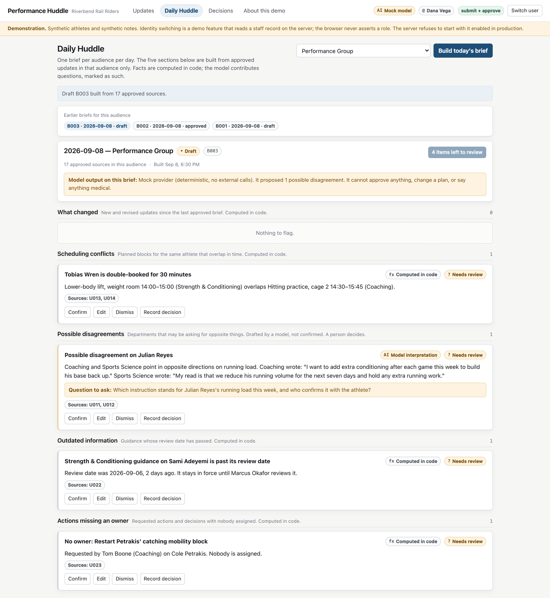

# Performance Huddle

A daily brief for a professional baseball performance department, built to run as a Microsoft Teams tab.

Strength and conditioning, sports science, medical, nutrition, and coaching each submit what the rest of
the group needs to know. The application turns those updates into one reviewed brief per audience: what
changed, what clashes, what might be a disagreement, what has gone stale, and what nobody owns. A person
confirms every item before the brief is approved, and the decisions that come out of it are recorded with
an owner, a due date, and a review date.

**Every athlete, staff member, note, and date in this repository is invented.** It is a portfolio project.
It is not in use with any club and has never held real athlete information.



## The idea in one line

Ordinary code computes every fact. The model summarizes, proposes possible disagreements, and drafts
questions. It cannot approve anything, change a plan, or say anything medical.

| Job | Done by |
|---|---|
| Time overlaps, expired review dates, missing owners, supersession, workflow state | Deterministic code, covered by tests |
| Summarizing notes, spotting possible semantic disagreements, drafting clarification questions | A model, labelled, and marked "needs review" until a person acts |
| Approving a brief, recording a decision, assigning an owner | A person with approval permission |

## Run it

```bash
npm install
npm run demo          # builds the client and serves everything on http://localhost:4000
```

Then pick a staff member on the sign-in screen. **Dana Vega** is the reviewer and sees the most.

No Microsoft account, no API key, and no network access is needed. The default demo makes **no external
calls of any kind**: the model provider is a deterministic mock, labelled as such everywhere its output
appears.

Other commands:

```bash
npm run dev           # API on :4000 with reload, Vite client on :5173
npm test              # 93 tests
npm run typecheck     # both TypeScript projects
```

The two-minute walkthrough is in [docs/DEMO-SCRIPT.md](docs/DEMO-SCRIPT.md).

## The three screens

**Updates.** Each submission names an athlete, a department, the operational update, an optional requested
action and owner, one audience, and a review date. Author and timestamp are recorded, and revisions keep
the earlier text rather than replacing it.

**Daily Huddle.** One brief per audience per day, in five sections: what changed, scheduling conflicts,
possible disagreements, outdated information, actions missing an owner. Every item links to the updates it
came from, is labelled as computed or as model output, and starts at "needs review". The brief cannot be
approved while any item is still waiting on a person.

**Decisions.** The agreed action, owner, rationale, due date, review date, and status. Open, completed, and
superseded. A superseded decision stays on the record with a link to the one that replaced it.

## What the demo dataset contains

A fictional Double-A club, twelve athletes, and seven days of updates from five departments, including:

- a lift booked over hitting practice for the same athlete,
- a coach asking for extra conditioning in the same week sports science asks to cut running volume,
- participation guidance sitting past its review date,
- an open decision with nobody assigned,
- a revised instruction that replaces an earlier one,
- two departments agreeing about the same athlete in a way that must **not** be flagged,
- ordinary days with nothing to report,
- restricted updates that most of the staff cannot see at all,
- one note carrying an attempt to give the assistant orders.

A second club, Harbor City Herons, exists so the organization boundary can be demonstrated.

## Security in short

Full detail is in [docs/SECURITY.md](docs/SECURITY.md); the matrix is in
[docs/ARCHITECTURE.md](docs/ARCHITECTURE.md).

- Every read and write checks organization, audience membership, and permission on the server, in code
  that never reads model output.
- Memberships are read from the staff directory on **every request**. A revocation is denied on the next
  call.
- Submitting and approving are separate permissions.
- Being able to read a source does not authorize repeating it to a wider group. A brief may only cite
  sources approved for its own audience, and exports carry the same boundary.
- Filtering happens before retrieval and again immediately before the model call. Athlete names are
  replaced with labels first.
- Withdrawing a source, or moving it to another audience, invalidates every brief that cited it.
- Routine logs carry identifiers, counts, and outcome codes. Never note text, never athlete names.
- Nothing is reachable without a session. There are no public links to staff information.

## Working code, and scaffolding

Being clear about this matters more than the demo looking finished.

| | Status |
|---|---|
| Three screens, authorization layer, deterministic detections, briefs, decisions, exports, search, notifications | **Working**, covered by tests |
| Mock model provider | **Working**, deterministic, no network |
| Azure OpenAI adapter | **Written, never run against Azure.** Unit-tested with a stubbed fetch |
| Teams tab manifest, Teams JS bootstrap, Entra ID token validation | **Written, never run against a Microsoft tenant.** Token validation is unit-tested against locally generated keys |

Data lives in server memory and is rebuilt from `data/seed/` on every start. See
[docs/DATA-HANDLING.md](docs/DATA-HANDLING.md) for what a real deployment has to replace.

## Repository

```
data/seed/          the synthetic dataset, as JSON with day offsets
src/server/
  auth/             authorization predicates, session, identity, Entra validation
  domain/           deterministic detections, brief assembly and review
  ai/               provider contract, validation, mock provider, Azure adapter
  data/             in-memory store and seed loader
  routes/           the HTTP surface
  log/              redaction and logging
src/web/            React client: three screens plus About
src/shared/         types used by both
teams/              manifest template and icons
docs/               architecture, security, data handling, Teams, demo, evaluation, case study
tests/              93 tests
```

## Documentation

- [Architecture and permissions matrix](docs/ARCHITECTURE.md)
- [Security model](docs/SECURITY.md)
- [Data processing, retention, deletion, logging](docs/DATA-HANDLING.md)
- [Teams integration and tenant configuration](docs/TEAMS-INTEGRATION.md)
- [Two-minute demonstration script](docs/DEMO-SCRIPT.md)
- [Evaluation plan](docs/EVALUATION-PLAN.md)
- [Case study](docs/CASE-STUDY.md)

## Not for production as-is

Do not connect real organizational data, install into a real tenant, or publish this externally without
authorization. [docs/SECURITY.md](docs/SECURITY.md) lists what an organization has to supply first.
