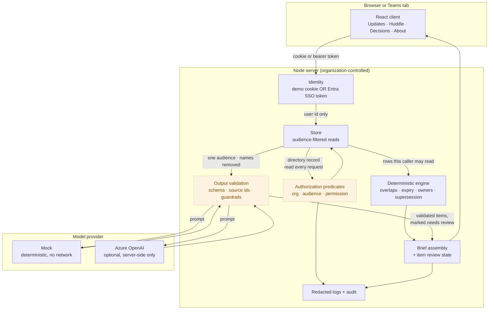

# Architecture

## The shape of it



The two shaded boxes are the gates. Nothing reaches a response or a model without passing the first.
Nothing from a model reaches a brief without passing the second.

## Request path, in order

1. **Identify.** The session cookie carries a user id and nothing else. In production the identity comes
   from an Entra ID token instead. Either way the id is only a lookup key.
2. **Resolve.** The staff record is read from the directory on this request. Organization, audiences, and
   permissions come from there, never from the request.
3. **Authorize before retrieval.** Reads go through `listUpdatesVisibleTo(user, ...)` and
   `getUpdateVisibleTo(user, id)`. A row the caller may not see is never loaded, so it cannot leak through
   a response, an export, a search result, a notification, or an error message.
4. **Compute.** The deterministic engine runs over the authorized rows.
5. **Authorize again before the model.** Sources are re-checked one by one, athlete names are replaced
   with per-brief labels, and only sources whose audience equals the brief's audience are included.
6. **Validate what comes back.** Schema, then source ids against the allow-list, then the guardrails. What
   survives becomes an item marked `needs_review`.
7. **A person decides.** Confirm, edit, or dismiss each item. The brief cannot be approved while anything
   is still pending.
8. **Log.** Identifiers, counts, and outcome codes only.

## Modules

| Path | Holds | Depends on |
|---|---|---|
| `src/shared/types.ts` | Types used by client and server | nothing |
| `src/server/config.ts` | Environment parsing and the startup refusals | nothing |
| `src/server/clock.ts` | One source of "now", plus date arithmetic | nothing |
| `src/server/auth/authorize.ts` | Every authorization predicate, as pure functions | types |
| `src/server/auth/session.ts` | HMAC session cookie, signing and verification | node:crypto |
| `src/server/auth/entra.ts` | Entra ID token validation (scaffolding) | node:crypto |
| `src/server/auth/identity.ts` | Demo and Entra identity resolvers | store, config |
| `src/server/data/store.ts` | In-memory repository with audience-filtered reads | authorize |
| `src/server/data/seed.ts` | Builds the synthetic dataset from an anchor date | clock |
| `src/server/domain/deterministic.ts` | Overlaps, expiry, owners, supersession, injection markers | clock, types |
| `src/server/domain/brief.ts` | Brief assembly, item review, approval | store, ai, deterministic |
| `src/server/ai/contract.ts` | Provider interface, output schema, validation, guardrails | zod |
| `src/server/ai/mock.ts` | Deterministic provider | deterministic |
| `src/server/ai/azure.ts` | Azure OpenAI adapter (scaffolding) | config, prompt |
| `src/server/routes/*` | The HTTP surface, one file per resource | all of the above |
| `src/server/log/logger.ts` | Field redaction | nothing |

## Permissions matrix

Two permissions (`submit`, `approve`) and audience membership. Both are read from the staff directory on
every request. "Member" means the caller belongs to the audience the resource names.

| Action | Needs | Also requires | Enforced in |
|---|---|---|---|
| Read an update | `member` | same organization | `canReadUpdate` |
| Read a withdrawn update | `member` and (author or `approve`) | same organization | `canReadUpdate` |
| Search updates | `member` | filtered before the query runs | `insights.ts` |
| Submit an update | `submit` + `member` of the target audience | athlete and named owner in the same organization | `canSubmitTo` |
| Revise an update | author only | must still be readable | `updates.ts` |
| Withdraw an update | author or `approve` | invalidates briefs citing it | `updates.ts` |
| Move an update to another audience | `approve` + `member` of the target audience | invalidates briefs citing it | `updates.ts` |
| Build a brief | `approve` + `member` | sources restricted to that audience | `canReviewAudience` |
| Confirm, edit, dismiss an item | `approve` + `member` | brief must be a draft | `reviewBriefItem` |
| Approve a brief | `approve` + `member` | zero items still `needs_review` | `approveBrief` |
| Read a brief | `member` | same organization | `canReadBrief` |
| Export a brief | `member` | brief must be `approved`, not `invalidated` | `briefs.ts` |
| Read a decision | `member` | same organization | `canReadDecision` |
| Record a decision | `approve` + `member` | sources re-filtered to that audience | `decisions.ts` |
| Change or complete a decision | `approve` + `member` | a superseded decision is read-only | `decisions.ts` |
| Read notifications | `member` | derived only from readable records | `insights.ts` |
| Read the audit trail | `approve` | own organization only | `insights.ts` |
| Switch demo identity | demo mode on | refused when `NODE_ENV=production` | `config.ts`, `session.ts` |
| Anything, with no session | denied | every data route | `requireUser` |

### The demo cast

| Person | Permissions | Audiences | Shows |
|---|---|---|---|
| Dana Vega, Performance Coordinator | submit, approve | Performance, Baseball Ops, Medical | The full workflow |
| Marcus Okafor, S&C | submit | Performance, Baseball Ops | Submit without approve; restricted records invisible |
| Priya Lindqvist, Sports Scientist | submit | Performance, Baseball Ops | The other half of the disagreement |
| Alex Serrano, Athletic Trainer | submit | Performance, Baseball Ops, Medical | Who writes participation guidance |
| Rae Nakamura, Dietitian | submit | Performance, Baseball Ops | The compatible perspective |
| Tom Boone, Hitting Coach | submit | Performance, Baseball Ops | The scheduling clash and the unowned action |
| Jordan Ellis, Intern | none | Baseball Ops | Read-only, narrowest view |
| Sam Cortez, Sports Science Assistant | submit | Performance, Baseball Ops | Used for the revocation test |
| Casey Hale, Harbor City | submit, approve | Harbor City only | Organization isolation |

## Data model

```
Organization 1─* Audience 1─* Update *─1 Athlete
                     │            └─* UpdateRevision
                     ├─* Brief 1─* BriefItem ──> sourceUpdateIds[]
                     └─* Decision ──> sourceUpdateIds[], briefId?, supersedes/supersededBy
StaffUser ──> orgId, permissions[], audienceIds[]
```

One update names exactly one audience. One brief names exactly one audience and cites only sources from
it. That single rule is what makes the boundary checkable rather than a matter of judgement.

## Choices worth defending

**In-memory store.** The authorization layer is identical over any backing store, and an in-memory
repository keeps the demo reproducible with one `npm install` and no native dependencies. The seam is
`src/server/data/store.ts`; see [DATA-HANDLING.md](DATA-HANDLING.md) for the swap.

**Dates relative to an anchor.** The dataset carries day offsets, not fixed dates, so the demo always
reads as this week while tests pin the anchor and get identical output.

**A mock provider that actually computes something.** It tags sentences with a load topic and a direction
and reports where two departments point opposite ways. It is simple enough to read in one sitting and it
gets both the true positive and the true negative in the dataset right, which is the point.

**No `authorization` block in the Teams manifest.** The application reads nothing from Teams. Asking for
resource-specific permissions it does not need would be the wrong default for medical-adjacent work.
